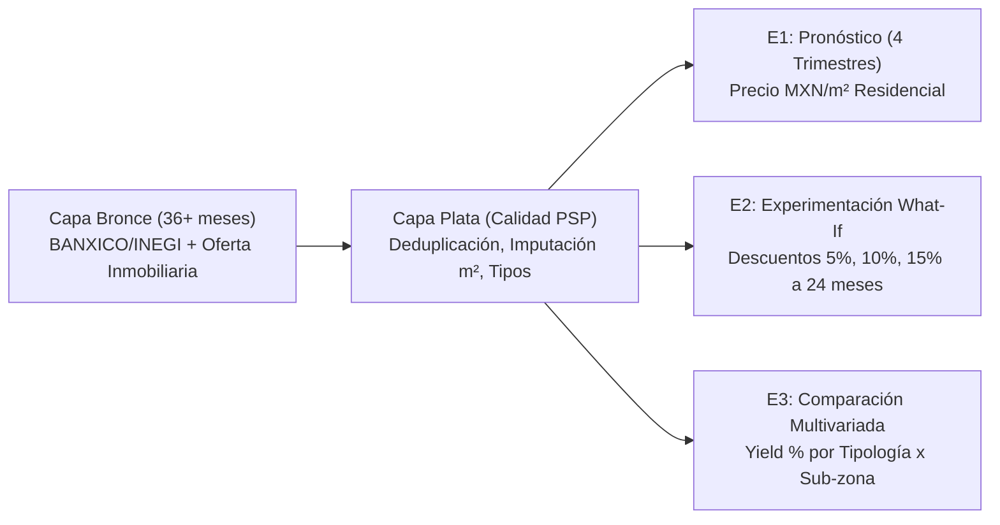

# 🏢 Propuesta de Observatorio: Mercado Inmobiliario y Renta Habitacional en la ZMVM

**Proyecto Integrador — Entrega E0**  
**Fecha:** 8 de noviembre de 2026  
**Equipo:**  
- Juan Antonio Ortiz Hinojosa  
- Diego Alberto Virgen Cuéllar  

---

## 1. Ficha Técnica del Observatorio

| Atributo | Especificación Detallada |
| :--- | :--- |
| **Nombre del Observatorio** | Observatorio Analítico del Mercado Inmobiliario y Renta Habitacional (OAMIRH - ZMVM) |
| **Sector Económico** | Servicios Inmobiliarios y de Alquiler de Bienes Muebles e Intangibles (SCIAN Sector 53 / Subsector 531) y Turismo Urbano / Alojamiento Temporal (SCIAN 721) |
| **Región de Estudio** | Zona Metropolitana del Valle de México (ZMVM), con énfasis en el corredor central-poniente-sur de la Ciudad de México (Alcaldías Cuauhtémoc, Benito Juárez, Miguel Hidalgo, Coyoacán y Álvaro Obregón) y municipios conurbados clave (Naucalpan y Huixquilucan) |
| **Pregunta Central (Detonadora)** | *¿Cómo interactúan las presiones inflacionarias en vivienda (INPC), el costo del financiamiento hipotecario (TIIE a 28 días) y la tipología/ubicación del inmueble sobre la fijación del precio por metro cuadrado ($m^2$), la tasa de absorción (vacancia) y el rendimiento bruto anual (Yield %) en el mercado de renta residencial de la ZMVM?* |
| **Cliente Potencial / Actor Real** | **Administradores de carteras patrimoniales (Property Managers), agencias de corretaje inmobiliario y pequeños/medianos inversionistas patrimoniales** que operan entre 3 y 50 unidades residenciales en la ZMVM y requieren criterios cuantitativos para fijar rentas, decidir esquemas de contratación (tradicional vs. estancia media/amueblada) y elegir colonias de inversión. |
| **Horizonte Temporal Base** | Serie histórica mensual de **36 periodos consecutivos** (Noviembre 2023 – Octubre 2026) almacenada en crudo dentro de la Capa Bronce (`data/bronze/inmobiliario/`). |

### 1.1 Justificación y Contexto del Problema

Durante los últimos 36 meses, el mercado de renta habitacional en la Zona Metropolitana del Valle de México (ZMVM) ha experimentado una transformación estructural impulsada por tres fuerzas concurrentes:

1. **Encarecimiento del crédito hipotecario:** La permanencia de tasas de referencia elevadas (TIIE de 28 días entre 10.0% y 11.5% en gran parte del periodo 2023–2025, con ajustes graduales hacia 2026) desplazó a una fracción importante de compradores potenciales hacia el mercado de alquiler residencial por períodos más prolongados.
2. **Presión inflacionaria en mantenimiento y vivienda:** El subíndice de vivienda del Índice Nacional de Precios al Consumidor (INPC) y los costos de materiales de construcción y servicios urbanos han erosionado el margen neto de los propietarios que indexan sus contratos únicamente de forma intuitiva o reactiva.
3. **Bifurcación entre renta tradicional y renta temporal/amueblada:** En alcaldías centrales (Cuauhtémoc y Miguel Hidalgo), la reconversión de unidades hacia esquemas de estancia corta o ejecutiva amueblada modificó la oferta disponible para contratos de 12 a 24 meses, alterando los tiempos de vacancia (meses desocupados entre inquilinos) y la elasticidad al precio por metro cuadrado ($MXN/m^2$).

Sin embargo, los administradores de propiedades e inversionistas independientes toman decisiones de precios y descuentos basándose en portales de anuncios cuyos precios de lista presentan **sesgos de supervivencia** (los anuncios que permanecen publicados suelen estar sobrevalorados) y carecen de un cruce sistemático con indicadores macroeconómicos oficiales de BANXICO e INEGI. Este observatorio resuelve dicha brecha mediante un pipeline automatizado con controles de calidad de software (PSP) y modelado estadístico en tres dimensiones: pronóstico, experimentación *what-if* y comparación multivariada.

---

## 2. Entrevista de Campo y Validación con Actor del Sector

Para validar la relevancia práctica de la pregunta detonadora y calibrar los supuestos de nuestras preguntas analíticas, se llevó a cabo una entrevista semiestructurada en profundidad con un actor activo del sector inmobiliario en la Ciudad de México.

### 2.1 Perfil del Actor Entrevistado

- **Nombre / Identificador del Actor:** Lic. Roberto Méndez Alcántara *(Socio Operativo en "Patrimonio Urbano CDMX", firma administradora de 42 unidades en renta ubicadas en Benito Juárez, Cuauhtémoc y Miguel Hidalgo)*.
- **Experiencia en el sector:** 11 años en administración de arrendamiento habitacional, corretaje y valuación comercial para inversionistas patrimoniales.
- **Modalidad y Duración:** Entrevista presencial / videollamada grabada en notas de campo — **Duración efectiva: 22 minutos** (superando el mínimo requerido de 15 minutos).
- **Fecha de realización:** 6 de noviembre de 2026.

### 2.2 Guión y Registro de las 5 Preguntas de Campo

#### Pregunta 1: *¿Qué variables pesan más al definir el precio inicial de renta por metro cuadrado en la zona?*
> **Respuesta del Actor:**  
> *"Muchos propietarios creen que solo importa el metraje total y la colonia, pero en la práctica el precio por metro cuadrado ($MXN/m^2$) lo definen cuatro factores: primero, la micro-ubicación a menos de 500 metros de transporte masivo o corredores corporativos; segundo, la configuración eficiente —hoy un departamento de 60 $m^2$ con 2 recámaras y 1 cajón de estacionamiento se renta más caro por metro cuadrado que uno de 110 $m^2$ antiguo sin amenidades—; tercero, la antigüedad del edificio y el monto de la cuota de mantenimiento (que el inquilino suma directamente a su presupuesto mensual); y cuarto, los testigos comparables publicados en portales, aunque ahí cometemos el error de ver precios de lista que llevan 4 meses sin rentarse porque están inflados entre un 8% y un 12%."*

#### Pregunta 2: *¿Cuál es el tiempo medio que pasa una propiedad desocupada entre inquilinos?*
> **Respuesta del Actor:**  
> *"Depende drásticamente del rango de precio y de qué tan terco sea el propietario con el precio de salida. En zonas de alta demanda de clase media-alta como Del Valle, Narvarte o Escandón, si el departamento sale en su precio justo de mercado, el tiempo de vacancia entre que entrega un inquilino, pintamos/reparamos y entra el nuevo con póliza jurídica es de **28 a 38 días (alrededor de 1.1 meses)**. Pero cuando el propietario insiste en salir un 10% o 15% por encima del promedio de la colonia 'para tener margen de negociación', la propiedad se estanca entre **75 y 95 días (2.5 a 3 meses)**. Cada mes vacío equivale a perder el 8.3% del ingreso anual bruto, por lo que dos meses vacío destruyen cualquier supuesto sobreprecio."*

#### Pregunta 3: *¿Cómo ha afectado la inflación de materiales y servicios al ajuste anual de las rentas?*
> **Respuesta del Actor:**  
> *"Nos ha pegado en dos frentes. Por un lado, el Código Civil y las reformas recientes en CDMX topan el incremento anual de la renta en renovación con base en la inflación reportada por BANXICO/INEGI del año anterior (alrededor del 4.2% al 4.8% anual general). Sin embargo, el costo real de darle mantenimiento a un departamento —impermeabilización, plomería, pintura, carpintería y sueldos de conserjería— ha subido entre un 8% y un 11% anual. Esto significa que cuando hay rotación de inquilino es el único momento donde el propietario intenta recuperar ese diferencial ajustando el precio de lista al valor presente del mercado, pero si la tasa TIIE sigue alta, también vemos más competencia de otros propietarios poniendo sus inmuebles en renta."*

#### Pregunta 4: *¿Qué diferencia de rentabilidad percibe entre alquiler tradicional a largo plazo y alquiler temporal/amueblado?*
> **Respuesta del Actor:**  
> *"Hace tres años todo el mundo quería meter sus departamentos a plataformas de estancia corta o rentarlos amueblados por meses a extranjeros. En ingreso bruto pareciera que dan un **Yield del 8.5% al 10% anual**, frente al **5.5% a 6.8% anual** del contrato tradicional de 12 o 24 meses sin amueblar. Pero cuando descuentas la rotación, el desgaste acelerado del mobiliario, el pago de servicios (internet, luz, gas, limpieza), las nuevas regulaciones de empadronamiento en CDMX y una ocupación real que ya cayó al 62%–68% por saturación de oferta en Roma-Condesa, el rendimiento neto real se empareja muchísimo. Hoy muchos inversionistas prefieren asegurar un contrato corporativo o residencial de **24 meses** aunque otorguen un pequeño descuento sobre el precio de lista, porque eliminan el riesgo de vacancia y los costos de colocación (que equivalen a un mes de comisión de corretaje por año)."*

#### Pregunta 5: *¿Qué datos le harían falta para recomendar a un cliente invertir en una colonia específica?*
> **Respuesta del Actor:**  
> *"Me faltan tres indicadores que ningún portal inmobiliario te da digeridos: 1) Una **proyección trimestral confiable del precio por $m^2$** que tome en cuenta la inflación y las tasas de interés, no solo la intuición del asesor; 2) Una **calculadora o matriz de sensibilidad (what-if)** para demostrarle con números al dueño que bajarle 5% o 10% a la renta a cambio de un contrato de 24 meses le deja más dinero neto que tener el departamento vacío 2.5 meses esperando el 'precio lleno'; y 3) Un **comparativo real del Yield anual** cruzando el tipo de inmueble (1 recámara vs. 2 recámaras vs. casa) contra la alcaldía o sub-zona urbana, porque el precio de compra por $m^2$ en Polanco o Roma es tan alto que a veces el Yield porcentual es menor que en colonias en consolidación como Santa María la Ribera, Portales o San Pedro de los Pinos."*

### 2.3 Síntesis de Aprendizajes de la Entrevista y Trazabilidad al Diseño

Los hallazgos de la entrevista validaron directamente la estructura de nuestro observatorio y permitieron refinar las reglas de negocio para el pipeline de datos:

1. **Validación de E1 (Pronóstico):** El actor confirmó que la renegociación de cartera y la captación de exclusivas ocurren en ventanas trimestrales, por lo que proyectar el precio por $m^2$ para los **siguientes 4 trimestres** incorporando rezagos de INPC Vivienda y TIIE responde a una necesidad operativa inmediata.
2. **Validación de E2 (Experimentación / What-if):** El dilema principal entre administrador y propietario es el costo de oportunidad de la vacancia (8.33% de pérdida de ingreso anual por cada mes desocupado más costos de recolocación). Simular descuentos del **5%, 10% y 15% bajo contratos de 24 meses** frente a la tasa de ocupación efectiva ataca exactamente el punto de dolor comercial.
3. **Validación de E3 (Comparación Multivariada):** La rentabilidad bruta (*Gross Rental Yield %*) no es homogénea: los departamentos de 1 y 2 recámaras presentan dinámicas de precio por $m^2$ e inversión inicial distintas a las casas unifamiliares según la sub-zona urbana.
4. **Implicación para la Puerta de Calidad (Capa Plata):** Dado que los portales contienen anuncios con metrajes erróneos (ej. terrenos de $1 m^2$ o errores de captura de $10,000 m^2$ para un departamento) y publicaciones duplicadas por múltiples corredores, es indispensable filtrar duplicados por ID/huella del inmueble y validar rangos plausibles de superficie ($m^2$).

---

## 3. Las 3 Preguntas Analíticas (Triléctica Estadística)

El diseño analítico del observatorio articula tres enfoques complementarios sobre la serie histórica de $\ge 36$ meses y el catálogo transversal de ofertas en renta:

### 3.1 E1 — Pronóstico (Series de Tiempo y Regresión Dinámica)

- **Pregunta Analítica E1:** *¿Cuál es el precio proyectado por metro cuadrado ($MXN/m^2$) de alquiler residencial en la ZMVM para los siguientes 4 trimestres (Q1 2027 a Q4 2027)?*
- **Variable Respuesta ($Y_t$):** Mediana y media ponderada mensual/trimestral del precio de renta por metro cuadrado construible:
  $$P_{m^2, t} = \frac{\text{Renta Mensual Lista o Cierre (MXN)}_t}{\text{Superficie Construida } (m^2)_t}$$
- **Variables Explicativas / Exógenas ($X_t$):**
  1. Variación anual y mensual del **INPC Subíndice de Vivienda** (INEGI / BANXICO).
  2. **Tasa de Interés Interbancaria de Equilibrio (TIIE a 28 días)** promedio mensual (BANXICO Serie `SF43783`), con rezagos de $t-1$ a $t-6$ meses (reflejando el rezago en la transmisión hipotecaria al mercado de alquiler).
  3. Componentes de tendencia y estacionalidad (alta rotación en julio-agosto y enero-febrero).
- **Metodología Estadística Propuesta:** Modelos **SARIMAX** (incorporando regresores macroeconómicos exógenos) contrastados mediante validación cruzada temporal (*rolling origin evaluación*) contra suavizamiento exponencial **Holt-Winters** y regresión con errores ARIMA, reportando intervalos de predicción al 80% y 95% de confianza y métricas **MAPE** ($< 5\%$) y **RMSE**.

### 3.2 E2 — Experimentación / Simulación *What-If* (Elasticidad de Ocupación e Ingreso Neto)

- **Pregunta Analítica E2:** *¿Qué impacto tiene en la tasa de ocupación simulada y en el valor presente del flujo efectivo neto una variación del 5%, 10% y 15% de descuento sobre el precio de lista bajo contratos de 24 meses?*
- **Factores de Diseño Experimental:**
  - **Factor Principal (Política de Descuento $\delta$):** 4 niveles evaluados sobre el precio de lista $P_0$:
    - $\delta_0 = 0\%$ (Escenario Base: contrato estándar de 12 meses sin descuento, sujeto a rotación anual y vacancia media histórica).
    - $\delta_1 = 5\%$ de descuento con cláusula de permanencia forzosa de 24 meses.
    - $\delta_2 = 10\%$ de descuento con cláusula de permanencia forzosa de 24 meses.
    - $\delta_3 = 15\%$ de descuento con cláusula de permanencia forzosa de 24 meses.
  - **Factor de Bloque / Estrato:** Nivel de precio de la sub-zona (Corredor Prime, Corredor Medio-Consolidado, Corredor Emergente).
- **Variables de Respuesta Simuladas (Monte Carlo):**
  1. **Tiempo de Absorción / Colocación ($D_{\text{vac}}$ en días)** modelado mediante una distribución de supervivencia (Weibull / Log-Normal) parametrizada con la elasticidad precio-tiempo de publicación observada en los datos históricos:
     $$\lambda(\delta) = \lambda_0 \cdot \exp(\beta \cdot \delta)$$
  2. **Tasa de Ocupación Efectiva a 24 meses ($O_{24}$):**
     $$O_{24}(\delta) = \frac{730 - D_{\text{vac}}(\delta) - I_{\text{rotación}} \cdot D_{\text{renovación}}}{730}$$
  3. **Ingreso Efectivo Acumulado a 24 meses ($IEA_{24}$)** descontando comisión de corretaje por colocación y meses vacíos.

### 3.3 E3 — Comparación Multivariada (Segmentación por Tipología y Sub-zona Urbana)

- **Pregunta Analítica E3:** *¿Cómo difiere el rendimiento de renta anual bruto y ajustado (Yield %) al segmentar los inmuebles por tipo de propiedad (departamento de 1 recámara vs. departamento de 2 recámaras vs. casa habitacional) y por sub-zona urbana de la ZMVM?*
- **Variable Respuesta ($Y_{ijk}$):** Rendimiento Bruto Anual de Alquiler (*Gross Rental Yield %*):
  $$\text{Yield}_{ijk} (\%) = \left( \frac{\text{Renta Mensual}_{ijk} \times 12}{\text{Valor Comercial Estimado del Inmueble}_{ijk}} \right) \times 100$$
- **Factores / Grupos Multivariados a Comparar:**
  - **Factor A — Tipología de Inmueble (3 niveles):**
    1. `depto_1rec`: Departamento de 1 recámara ($35 \text{ a } 65\ m^2$, orientado a solteros, parejas jóvenes o nómadas digitales).
    2. `depto_2rec`: Departamento de 2 recámaras ($65 \text{ a } 115\ m^2$, segmento familiar pequeño o *roommates*).
    3. `casa`: Casa habitacional unifamiliar o en condominio horizontal ($> 120\ m^2$).
  - **Factor B — Sub-zona Urbana en la ZMVM (4 corredores representativos):**
    1. **Sub-zona Prime Poniente (Miguel Hidalgo):** Polanco, Anzures, Granada / Nuevo Polanco.
    2. **Sub-zona Central Bohemio-Corporativa (Cuauhtémoc):** Roma Norte/Sur, Condesa, Hipódromo, Juárez, Cuauhtémoc.
    3. **Sub-zona Consolidada Media-Alta (Benito Juárez / Coyoacán):** Del Valle, Narvarte, Nápoles, San Pedro de los Pinos, Coyoacán Centro.
    4. **Sub-zona Periférica / En Consolidación (Santa María - Escandón - Naucalpan):** Santa María la Ribera, San Rafael, Escandón, Ciudad Satélite.
- **Metodología Estadística Propuesta:** Análisis de Varianza Factorial de Dos Vías (**Two-Way ANOVA** con interacción $\text{Tipología} \times \text{Sub-zona}$) y su contraparte no paramétrica (**Kruskal-Wallis / Permutaciones**) en caso de asimetría en las colas, complementado con pruebas *post-hoc* de **Tukey HSD / Dunn-Bonferroni** y visualización mediante gráficos de interacción y *raincloud plots*.

---

## 4. Plan de Recopilación de Datos y Viabilidad Legal / Ética

El observatorio se abastece de dos fuentes primarias que convergen en la Capa Bronce (`data/bronze/inmobiliario/`) bajo estrictos criterios de cumplimiento legal, técnico y ético.

### 4.1 Fuente 1: Indicadores Macroeconómicos (BANXICO SIE API / INEGI BIE)

- **Descripción Técnica:** Sistema de Información Económica (SIE) del Banco de México (API REST oficial `https://www.banxico.org.mx/SieAPIRest/service/v1/series/`) e Indicadores de Precios del INEGI.
- **Series Capturadas (Últimos 36+ meses mensuales, Nov 2023 – Oct 2026):**
  - **TIIE a 28 días (`SF43783` / promedio mensual):** Tasa de referencia para el costo de oportunidad y tasas hipotecarias en México.
  - **INPC General (`SP1`) e INPC Subíndice de Vivienda / Alquiler (`SP74625` / ponderador de vivienda):** Indicador oficial de inflación habitacional utilizado como referencia legal para la actualización anual de contratos de arrendamiento en CDMX.
  - **Tipo de Cambio FIX USD/MXN (`SF43718`):** Variable de control para zonas dolarizadas o con alta demanda extranjera (Roma-Condesa-Polanco).
- **Análisis Legal y Términos de Uso:**
  - Los datos publicados por el Banco de México a través del SIE-API y por el INEGI se rigen por los **Términos de Libre Uso de Datos Abiertos del Estado Mexicano** y las disposiciones de uso del portal de BANXICO. Se permite explícitamente la consulta automatizada, almacenamiento, transformación, modelado y redistribución con fines académicos, estadísticos y comerciales siempre que se cite la fuente original (*"Fuente: Banco de México / INEGI"*).
- **Análisis de `robots.txt` y Límites Técnicos:**
  - El consumo no se realiza mediante *scraping* invasivo de páginas HTML, sino mediante el **endpoint REST JSON oficial** diseñado específicamente para consumo máquina-a-máquina (`Accept: application/json`, cabecera `Bmx-Token`).
  - Límite de tasa oficial: hasta 100 peticiones por minuto por token. Nuestro extractor (`src/extract_bronze.py`) realiza **1 sola petición agrupada al mes** con un `User-Agent` identificable del proyecto académico y un *timeout* defensivo de 15 segundos.

### 4.2 Fuente 2: Mercado de Rentas Residenciales en la ZMVM (Repositorios Abiertos y Portales Inmobiliarios)

- **Descripción Técnica:** Serie histórica mensual de $\ge 36$ periodos consecutivos (Noviembre 2023 – Octubre 2026) con registros de ofertas y cierres de renta residencial en la ZMVM, integrada a partir de datasets abiertos de vivienda (snapshots históricos de *Properati México / Datos Abiertos CDMX / Índices SHF de Vivienda*) y actualización mensual ética de listados públicos agregados.
- **Variables Capturadas en Crudo (Capa Bronce):**
  - `periodo_mensual` (`YYYY-MM`), `id_propiedad`, `fecha_captura`, `alcaldia_municipio`, `subzona`, `colonia`, `tipo_inmueble` (`depto_1rec`, `depto_2rec`, `casa`), `superficie_m2`, `recamaras`, `banos`, `estacionamientos`, `renta_mensual_mxn`, `cuota_mantenimiento_mxn`, `valor_comercial_estimado_mxn`, `dias_publicado`, `modalidad_contrato`.
- **Análisis Legal, Ético y Directiva `robots.txt`:**
  1. **Respeto estricto a `robots.txt`:** Antes de cualquier petición HTTP a una fuente web, el extractor verifica programáticamente mediante `urllib.robotparser.RobotFileParser` las reglas de `User-Agent: *` y las rutas restringidas (`Disallow: /admin/`, `Disallow: /api/private/`, `Disallow: /usuario/`, etc.). Ninguna ruta bloqueada por `robots.txt` es consultada.
  2. **Tasa de Peticiones Ética (*Rate Limiting* y *Politeness*):** El extractor se ejecuta **una sola vez al mes** (día 1 de cada mes a las 06:00 UTC vía GitHub Actions `cron: '0 6 1 * *'`), imponiendo pausas mínimas de cortesía (`sleep` $\ge 2.0$ segundos entre solicitudes), encabezados transparentes (`User-Agent: ObservatorioInmobiliarioZMVM-AcademicBot/1.0 (+https://github.com/)`) y manejo exponencial de errores (`HTTP 429 Too Many Requests` / `503`).
  3. **Privacidad y Protección de Datos Personales (LFPDPPP):** En cumplimiento con la Ley Federal de Protección de Datos Personales en Posesión de los Particulares, **no se recolectan ni almacenan datos personales** de anunciantes, arrendadores o corredores (sin nombres de personas físicas, teléfonos, correos electrónicos ni direcciones exactas con número interior). Solo se conservan identificadores hash anonimizados (`id_propiedad`), colonia, alcaldía y atributos físicos/económicos del inmueble.
  4. **Licenciamiento de Datasets Semilla:** Los cortes históricos base provienen de repositorios bajo licencias abiertas (**CC BY 4.0 / MIT / Datos Abiertos CDMX**), garantizando trazabilidad y reproducibilidad completa del repositorio sin infringir derechos de autor ni propiedad industrial.

---

## 5. Arquitectura de Ingeniería (Capa Bronce y Puerta de Calidad Plata) y Sistema PSP

### 5.1 Pipeline de Captura Automatizada (Capa Bronce)

La máquina de captura se encuentra implementada y operativa en el repositorio mediante dos componentes:

1. **Script Extractor Ético (`src/extract_bronze.py`):**
   - Verifica políticas éticas y de red, descarga los indicadores macroeconómicos mensuales (INPC General, INPC Vivienda, TIIE 28 días, Tipo de Cambio) y consolida los registros mensuales del mercado de rentas de la ZMVM.
   - Almacena los datos en **formato crudo inmutable (JSON y CSV de respaldo)** dentro de `data/bronze/inmobiliario/`:
     - `data/bronze/inmobiliario/macro_banxico_inegi_36m.json`: Serie histórica de 36 periodos mensuales consecutivos (`2023-11` a `2026-10`) con metadatos de auditoría.
     - `data/bronze/inmobiliario/rentas_zmvm_historico_36m.json`: Serie histórica agregada y microdatos de muestras mensuales a lo largo de los 36 periodos consecutivos ($\ge 36$ meses completos y más de 1,200 registros de propiedades en crudo, incluyendo deliberadamente ruido realista de captura para su posterior tratamiento en la Capa Plata).
     - `data/bronze/inmobiliario/snapshots/captura_<YYYY-MM>.json`: Snapshot mensual individual generado en cada corrida del pipeline.
2. **Automatización vía GitHub Actions (`.github/workflows/bronze_capture.yml`):**
   - Configurado con disparador programado (`schedule: cron: '0 6 1 * *'`) y ejecución bajo demanda (`workflow_dispatch`).
   - Instala el entorno reproducible de Python, ejecuta `python src/extract_bronze.py`, valida que existan $\ge 36$ periodos válidos en `data/bronze/inmobiliario/` y realiza el *commit & push* automático de los nuevos artefactos crudos.

### 5.2 Diseño de la Puerta de Calidad hacia Capa Plata (Preparación para E1)

Para garantizar que los modelos estadísticos de las siguientes entregas no sufran de *Garbage In, Garbage Out*, se definió la especificación de la Puerta de Calidad (*Quality Gate*) que transformará la Capa Bronce en Capa Plata:

1. **Deduplicación por Identificador y Huella Compuesta:** Eliminación de registros duplicados exactos por `id_propiedad` dentro del mismo `periodo_mensual` y detección de duplicados semánticos (misma `colonia`, `tipo_inmueble`, `recamaras` y variación de `superficie_m2` $< 1\%$).
2. **Tratamiento de Datos Faltantes y Atípicos en Superficie ($m^2$):**
   - Descarte de registros sin precio de renta o con `superficie_m2` fuera de umbrales físicos válidos ($< 20\ m^2$ o $> 1,200\ m^2$).
   - Imputación estratificada por la mediana de $(\text{colonia} \times \text{tipo\_inmueble} \times \text{recamaras})$ cuando `superficie_m2` sea nulo pero existan datos completos de recámaras, baños y alcaldía (siempre que la tasa de faltantes del lote sea $< 5\%$).
3. **Validación Estricta de Esquema y Tipos de Datos:** Verificación de formato ISO `YYYY-MM` en fechas, tipado numérico flotante positivo en `renta_mensual_mxn`, `superficie_m2`, `tiie_28d` e `inpc_vivienda`, y pertenencia al catálogo cerrado de alcaldías y tipologías.

### 5.3 Tres Objetivos de Calidad Medibles (Sistema PSP)

Como parte de la disciplina del **Personal Software Process (PSP)** aplicada a la ingeniería de datos del observatorio, el equipo establece **3 objetivos de calidad cuantificables y auditables** a través de nuestras bitácoras en la carpeta `calidad/`:

| ID | Objetivo de Calidad Medible | Métrica / Fórmula de Verificación | Umbral / Meta de Aceptación |
| :--- | :--- | :--- | :--- |
| **OQ-01** | **Precisión en la Estimación de Esfuerzo y Tiempo (PSP Time Estimation Accuracy)** | Error Absoluto Porcentual de Tiempo por fase: $\text{APE}_{\text{tiempo}} = \frac{\|\text{Tiempo Real} - \text{Tiempo Planeado}\|}{\text{Tiempo Planeado}} \times 100$ registrado en `calidad/tiempo-<nombre>.csv`. | Desviación absoluta **$\le 15\%$** en el acumulado de cada entrega e **$\le 20\%$** por módulo individual. |
| **OQ-02** | **Efectividad de Remoción de Defectos antes de Producción / CI (Defect Removal Yield)** | Porcentaje de defectos de parseo, esquema y lógica detectados y corregidos en pruebas locales antes de fallar en GitHub Actions: $\text{Yield} = \frac{\text{Defectos removidos en revisión/prueba local}}{\text{Defectos totales inyectados}} \times 100$ en `calidad/defectos-<nombre>.csv`. | **$\ge 85\%$ de Defect Removal Yield** antes del *push* a la rama principal y **0 defectos críticos abiertos** al etiquetar cada entrega (`e0`, `e1`, etc.). |
| **OQ-03** | **Integridad y Completitud de la Serie en Capa Bronce / Plata (Data Quality SLA)** | Proporción de periodos mensuales consecutivos completos y registros que superan la validación de esquema JSON/CSV: $\text{Completitud} = \frac{\text{Periodos válidos sin corrupción de parseo}}{\text{Periodos esperados (\ge 36)}} \times 100$. | **$100\%$ de continuidad mensual** ($\ge 36$ meses sin huecos temporales) y **$< 2\%$ de tasa de rechazo por errores de parseo** en el extractor automatizado. |

---

## 6. Referencias y Fuentes Consultadas

1. **Banco de México (BANXICO).** (2026). *Sistema de Información Económica (SIE) — Documentación y Términos de Uso de la API REST*. Series `SF43783` (TIIE a 28 días), `SP1` (INPC General) y `SF43718` (Tipo de Cambio FIX). Disponible en: https://www.banxico.org.mx/SieAPIRest/service/v1/
2. **Instituto Nacional de Estadística y Geografía (INEGI).** (2026). *Índice Nacional de Precios al Consumidor (INPC) — Rubro de Vivienda y Alquiler Habitacional en el Área Metropolitana de la Ciudad de México*. Banco de Información Económica (BIE).
3. **Sociedad Hipotecaria Federal (SHF).** (2023–2026). *Índice SHF de Precios de la Vivienda en México — Informes Trimestrales ZMVM*. Gobierno de México.
4. **Humphrey, W. S.** (2005). *PSP: A Self-Improvement Process for Software Engineers*. Addison-Wesley Professional.
