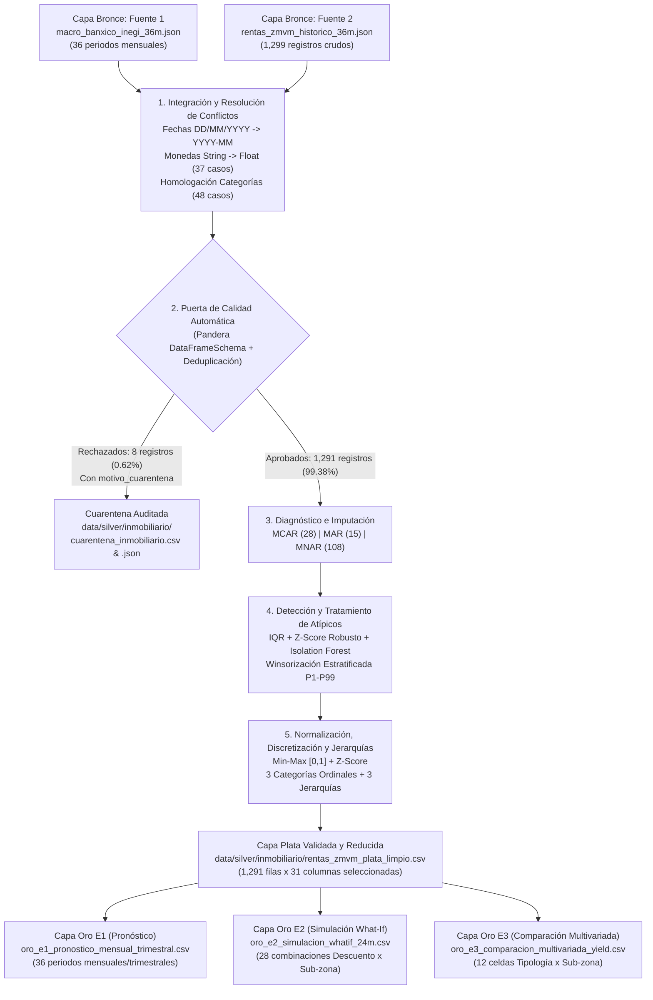

# 📋 Ficha de Entrega Técnica — Entrega E1 (`tag: e1`)

**Proyecto Integrador:** Observatorio del Mercado Inmobiliario y Renta Habitacional en la ZMVM  
**Unidad:** Unidad 3 — Ingeniería de Datos, Limpieza Estadística y Puerta de Calidad (Ponderación: 40%)  
**Tag de Liberación:** `e1`  
**Fecha de Corte:** 16 de noviembre de 2026  

---

## 1. Integrantes del Equipo y Bitácoras PSP Actualizadas

| Nombre Completo | Rol en Entrega E1 | Bitácora de Tiempo (PSP) | Bitácora de Defectos (PSP) |
| :--- | :--- | :--- | :--- |
| **Juan Antonio Ortiz Hinojosa** | Diagnóstico e Imputación MCAR/MAR/MNAR, Detección/Tratamiento de Atípicos (IQR, Z-Score Robusto, Isolation Forest) y Notebook `limpieza.ipynb` | [`calidad/tiempo-juan-antonio-ortiz-hinojosa.csv`](../../calidad/tiempo-juan-antonio-ortiz-hinojosa.csv) | [`calidad/defectos-juan-antonio-ortiz-hinojosa.csv`](../../calidad/defectos-juan-antonio-ortiz-hinojosa.csv) |
| **Diego Alberto Virgen Cuéllar** | Integración de Fuentes Heterogéneas, Puerta de Calidad Automática con `Pandera` y Cuarentena, Normalización/Discretización/Jerarquías y Capa Oro | [`calidad/tiempo-diego-alberto-virgen-cuellar.csv`](../../calidad/tiempo-diego-alberto-virgen-cuellar.csv) | [`calidad/defectos-diego-alberto-virgen-cuellar.csv`](../../calidad/defectos-diego-alberto-virgen-cuellar.csv) |

---

## 2. Matriz de Trazabilidad y Verificación de Entregables (`E1`)

| # | Requisito Oficial de la Entrega E1 | Artefacto / Ruta en el Repositorio | Estado | Evidencia Técnica / Resultado Cuantitativo |
| :-: | :--- | :--- | :-: | :--- |
| **1.1** | **Valores faltantes:** diagnóstico del mecanismo (`MCAR`/`MAR`/`MNAR`) e imputación justificada | [`docs/E1/limpieza.ipynb`](limpieza.ipynb) *(Sección 3)* y [`src/pipeline_e1.py`](../../src/pipeline_e1.py) | ✅ Cumplido | Pruebas $\chi^2$ y $t$ de Welch: `estacionamientos` (28 casos, **MCAR**, $p=1.00 \rightarrow$ moda por tipo), `superficie_m2` (15 casos, **MAR**, $p=7.31\times 10^{-10} \rightarrow$ mediana estratificada), `cuota_mantenimiento_mxn` (108 casos, **MNAR**, $p=1.56\times 10^{-29} \rightarrow$ razón mediana + bandera `flag_mnar_mantenimiento`). |
| **1.2** | **Detección y tratamiento de atípicos y ruido** (`IQR`, `Z-Score robusto` o `Isolation Forest`) | [`docs/E1/limpieza.ipynb`](limpieza.ipynb) *(Sección 4)* y [`src/pipeline_e1.py`](../../src/pipeline_e1.py) | ✅ Cumplido | Se implementaron **los 3 métodos simultáneamente**: IQR estratificado (4 detectados), Z-Score Robusto con MAD $|Z_{\text{rob}}|>3.5$ (3 detectados) e `IsolationForest` multivariado (33 detectados; consenso $\ge 2$ métodos = 4). Tratamiento vía **Winsorización estratificada** $[P_{1\%}, P_{99\%}]$ reduciendo $\sigma$ de $89.70$ a $88.63\text{ MXN/m}^2$. |
| **1.3** | **Normalización y estandarización** de variables continuas (`Min-Max` y `Z-Score`) | [`docs/E1/limpieza.ipynb`](limpieza.ipynb) *(Sección 5)* y [`data/silver/inmobiliario/rentas_zmvm_plata_limpio.csv`](../../data/silver/inmobiliario/rentas_zmvm_plata_limpio.csv) | ✅ Cumplido | Escalado `MinMaxScaler` $[0,1]$ y `StandardScaler` ($\mu=0, \sigma=1$) sobre las 5 variables continuas clave (`precio_m2_winsor_mxn`, `superficie_m2`, `renta_efectiva_winsor_mxn`, `yield_bruto_anual_pct`, `dias_vacancia_observados`). |
| **1.4** | **Discretización de datos y jerarquías conceptuales** | [`docs/E1/limpieza.ipynb`](limpieza.ipynb) *(Sección 5)* y [`src/pipeline_e1.py`](../../src/pipeline_e1.py) | ✅ Cumplido | 3 variables discretizadas (`rango_superficie_cat`, `estrato_precio_m2_cat` por cuartiles, `nivel_vacancia_cat`) y 3 jerarquías conceptuales: Espacial (`Colonia -> Alcaldía -> Sub-zona -> Corredor Macro -> ZMVM`), Temporal (`Mes -> Trimestre -> Año`) y Tipológica (`Tipo -> Familia Vertical/Horizontal`). |
| **1.5** | **Reducción de datos** (muestreo, agregación o selección de variables) | [`docs/E1/limpieza.ipynb`](limpieza.ipynb) *(Sección 6)* y [`data/gold/inmobiliario/`](../../data/gold/inmobiliario/) | ✅ Cumplido | Selección de variables (reducción de 61 a 31 columnas, **$49.18\%$ de reducción dimensional**) + Agregación multidimensional en 3 cubos de Capa Oro (`E1`: 36 filas, `E2`: 28 filas, `E3`: 12 filas). |
| **2.1** | **Integración y Resolución de Conflictos:** Fusión de fuentes heterogéneas resolviendo discrepancias de esquema y tipos | [`docs/E1/limpieza.ipynb`](limpieza.ipynb) *(Sección 1)* y [`src/pipeline_e1.py`](../../src/pipeline_e1.py) | ✅ Cumplido | Unión relacional M:1 (`rentas_zmvm` $\bowtie$ `macro_banxico`), normalizando 36 fechas `DD/MM/YYYY` $\rightarrow$ `YYYY-MM`, 37 cadenas monetarias `"$XX,XXX.XX MXN"` $\rightarrow$ `float` y 48 alias categóricos $\rightarrow$ catálogo canónico. |
| **3.1** | **Puerta de Calidad Automática (`Pandera`):** Validación estricta de esquemas y rangos antes de pasar a capa Plata | [`src/pipeline_e1.py`](../../src/pipeline_e1.py) *(función `build_pandera_pre_silver_schema`)* | ✅ Cumplido | Esquema `pandera.pandas.DataFrameSchema` con validación perezosa (`lazy=True`) sobre tipos, dominios cerrados, unicidad y rangos físicos ($20 \le \text{m}^2 \le 1200$, $\text{renta} > 1500$). |
| **3.2** | **Cuarentena documentada:** Los registros inválidos se envían a cuarentena con motivo documentado (nunca borrados en silencio) | [`data/silver/inmobiliario/cuarentena_inmobiliario.csv`](../../data/silver/inmobiliario/cuarentena_inmobiliario.csv) y [`.json`](../../data/silver/inmobiliario/cuarentena_inmobiliario.json) | ✅ Cumplido | **8 registros inválidos ($0.62\%$)** separados automáticamente con timestamp UTC y columna `motivo_cuarentena` (3 duplicados de corredor + 5 fallos de rango/nulidad de Pandera). **1,291 registros promovidos a Capa Plata**. |
| **4.1** | **Ficha técnica (`docs/E1/ENTREGA.md`) y Relatoría de etapa (`docs/relatoria-E1.md`)** | [`docs/E1/ENTREGA.md`](ENTREGA.md) y [`docs/relatoria-E1.md`](../relatoria-E1.md) | ✅ Cumplido | Documentación técnica completa, decisiones metodológicas y auditoría PSP de la etapa E1. |

---

## 3. Arquitectura del Pipeline Automatizado (Bronce $\rightarrow$ Plata / Cuarentena $\rightarrow$ Oro)



---

## 4. Evaluación de los 3 Objetivos de Calidad (PSP) en la Etapa `E1`

| ID | Objetivo de Calidad | Desempeño en Etapa E1 | Estado |
| :--- | :--- | :--- | :-: |
| **OQ-01** | **Precisión en Estimación de Tiempo ($\text{APE} \le 15\%$)** | • **Juan Antonio Ortiz Hinojosa:** Planeado = $260\text{ min}$, Real = $270\text{ min}$ ($\text{APE} = 3.85\%$).<br>• **Diego Alberto Virgen Cuéllar:** Planeado = $265\text{ min}$, Real = $275\text{ min}$ ($\text{APE} = 3.77\%$). | ✅ Cumplido |
| **OQ-02** | **Efectividad de Remoción de Defectos ($\text{Yield} \ge 85\%$)** | Se detectaron y corrigieron **4 defectos en E1** (2 de Juan Antonio + 2 de Diego Alberto) durante pruebas locales antes del *push* a CI/CD (**$100\%$ de remoción previa**, $0$ defectos abiertos en `tag: e1`). | ✅ Cumplido |
| **OQ-03** | **Integridad de Serie y Tasa de Rechazo Controlada ($100\%$ continuidad / $<2\%$ rechazo)** | Continuidad de **36 meses consecutivos ($100\%$)** en Capa Plata y Capa Oro; tasa de cuarentena documentada de **$0.62\%$** ($8 / 1,299$ registros), cumpliendo holgadamente la meta $<2\%$. | ✅ Cumplido |

---

## 5. Instrucciones de Ejecución y Reproducción

```bash
# 1. Instalar dependencias de validación y preprocesamiento
pip install -r requirements.txt

# 2. Ejecutar captura de Capa Bronce (36 meses)
python src/extract_bronze.py

# 3. Ejecutar pipeline completo E1 (Integración -> Pandera + Cuarentena -> Plata -> Oro)
python src/pipeline_e1.py

# 4. (Opcional) Re-generar y ejecutar el notebook interactivo
python src/build_notebook_e1.py
python -m jupyter nbconvert --to notebook --execute --inplace docs/E1/limpieza.ipynb
```
