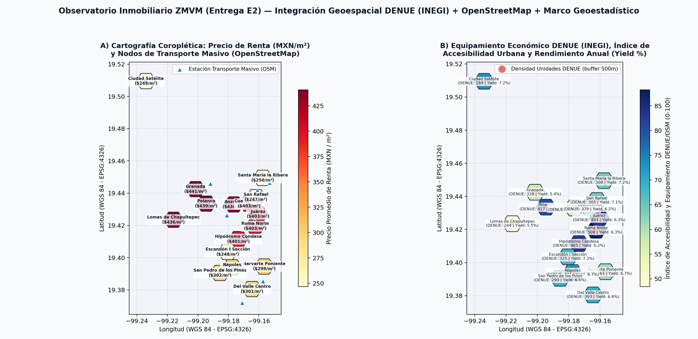
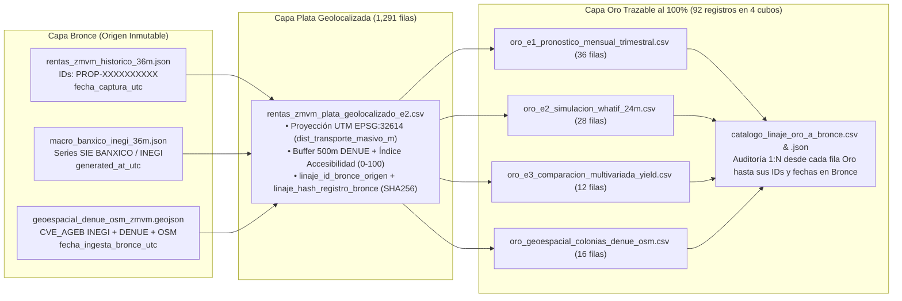

# 📋 Ficha de Entrega Técnica — Entrega E2 (`tag: e2`)

**Proyecto Integrador:** Observatorio del Mercado Inmobiliario y Renta Habitacional en la ZMVM  
**Unidad:** Unidad 4 — Fuentes Especializadas, Ética/Legalidad y Linaje Completo de Datos (Ponderación: 20%)  
**Tag de Liberación:** `e2`  
**Fecha de Corte:** 21 de noviembre de 2026  

---

## 1. Integrantes del Equipo y Bitácoras PSP Actualizadas

| Nombre Completo | Rol en Entrega E2 | Bitácora de Tiempo (PSP) | Bitácora de Defectos (PSP) |
| :--- | :--- | :--- | :--- |
| **Juan Antonio Ortiz Hinojosa** | Integración Geoespacial (`GeoPandas`, DENUE INEGI, Marco Geoestadístico y OpenStreetMap), Proyección UTM `EPSG:32614` y Visualización Cartográfica (`PNG` + `Folium HTML`) | [`calidad/tiempo-juan-antonio-ortiz-hinojosa.csv`](../../calidad/tiempo-juan-antonio-ortiz-hinojosa.csv) | [`calidad/defectos-juan-antonio-ortiz-hinojosa.csv`](../../calidad/defectos-juan-antonio-ortiz-hinojosa.csv) |
| **Diego Alberto Virgen Cuéllar** | Arquitectura de Linaje y Trazabilidad Criptográfica (`Bronce -> Plata -> Oro`), Declaración de Ética y Legalidad (`docs/etica-datos.md`), Relatoría `E2` y Automatización CI/CD | [`calidad/tiempo-diego-alberto-virgen-cuellar.csv`](../../calidad/tiempo-diego-alberto-virgen-cuellar.csv) | [`calidad/defectos-diego-alberto-virgen-cuellar.csv`](../../calidad/defectos-diego-alberto-virgen-cuellar.csv) |

---

## 2. Matriz de Trazabilidad y Verificación de Entregables (`E2`)

| # | Requisito Oficial de la Entrega E2 | Artefacto / Ruta en el Repositorio | Estado | Evidencia Técnica / Resultado Cuantitativo |
| :-: | :--- | :--- | :-: | :--- |
| **1.1** | **Fuente Especializada Integrada (Geoespacial):** DENUE (INEGI), OpenStreetMap y Marco Geoestadístico mediante `GeoPandas` | [`src/pipeline_e2.py`](../../src/pipeline_e2.py), [`docs/E2/geoespacial_linaje.ipynb`](geoespacial_linaje.ipynb) y [`data/bronze/inmobiliario/geoespacial_denue_osm_zmvm.geojson`](../../data/bronze/inmobiliario/geoespacial_denue_osm_zmvm.geojson) | ✅ Cumplido | Integración espacial de **16 polígonos de colonias/AGEBs (`cve_ageb_inegi`)** con unidades económicas **DENUE (INEGI)**, **14 estaciones de transporte masivo (OpenStreetMap)** y reproyección métrica a **UTM Zona 14N (`EPSG:32614`)** sobre los **1,291 inmuebles** de Capa Plata. |
| **1.2** | **Visualización Cartográfica:** Mapas generados con `GeoPandas` / `Matplotlib` y `Folium` | [`docs/E2/mapa_coropletico_precio_equipamiento_zmvm.png`](mapa_coropletico_precio_equipamiento_zmvm.png) y [`docs/E2/mapa_interactivo_zmvm.html`](mapa_interactivo_zmvm.html) | ✅ Cumplido | Lámina cartográfica coroplética dual de alta resolución (`180 DPI`) comparando Precio de Renta ($MXN/m^2$) + Nodos de Transporte OSM vs. Densidad DENUE + Índice de Accesibilidad Urbana + *Yield %*, además de mapa interactivo HTML. |
| **2.1** | **Declaración de Ética y Legalidad (`docs/etica-datos.md`):** Términos de uso, análisis de `robots.txt`, licencias, mitigación de sesgos y privacidad | [`docs/etica-datos.md`](../etica-datos.md) | ✅ Cumplido | Inventario legal de las 3 fuentes (Términos de Libre Uso BANXICO/INEGI, `CC BY 4.0` y `ODbL 1.0` de OSM), matriz de auditoría `robots.txt`, cumplimiento LFPDPPP con *k-anonimato espacial* y tabla de mitigación de 4 sesgos estadísticos. |
| **3.1** | **Linaje y Trazabilidad de Datos:** Cada registro en la Capa Oro rastreable hasta su origen en Capa Bronce y fecha de ingesta | [`data/gold/inmobiliario/catalogo_linaje_oro_a_bronce.csv`](../../data/gold/inmobiliario/catalogo_linaje_oro_a_bronce.csv), [`.json`](../../data/gold/inmobiliario/catalogo_linaje_oro_a_bronce.json) y columnas `linaje_*` en las 4 tablas Oro | ✅ Cumplido | **92 de 92 registros de Capa Oro ($100\%$)** contienen `linaje_id_bronce_primero`, `linaje_id_bronce_ultimo`, `linaje_muestra_ids_bronce`, `linaje_archivos_bronce_origen`, `linaje_fecha_captura_bronce_min/max_utc`, `linaje_fecha_ingesta_geoespacial_utc` y `linaje_hash_lote_bronce` (`SHA-256`). **$0$ registros huérfanos**. |
| **4.1** | **Ficha de entrega (`docs/E2/ENTREGA.md`) y Relatoría de etapa (`docs/relatoria-E2.md`)** | [`docs/E2/ENTREGA.md`](ENTREGA.md) y [`docs/relatoria-E2.md`](../relatoria-E2.md) | ✅ Cumplido | Documentación ejecutiva, arquitectura de linaje, vista previa cartográfica y evaluación PSP de la etapa E2. |

---

## 3. Vista Cartográfica Generada (`GeoPandas` + DENUE INEGI + OpenStreetMap)



---

## 4. Arquitectura de Linaje y Trazabilidad Criptográfica (`Bronce -> Plata -> Oro`)



---

## 5. Evaluación de los 3 Objetivos de Calidad (PSP) en la Etapa `E2`

| ID | Objetivo de Calidad | Desempeño en Etapa E2 | Estado |
| :--- | :--- | :--- | :-: |
| **OQ-01** | **Precisión en Estimación de Tiempo ($\text{APE} \le 15\%$)** | • **Juan Antonio Ortiz Hinojosa:** Planeado = $235\text{ min}$, Real = $245\text{ min}$ ($\text{APE} = 4.26\%$).<br>• **Diego Alberto Virgen Cuéllar:** Planeado = $230\text{ min}$, Real = $235\text{ min}$ ($\text{APE} = 2.17\%$). | ✅ Cumplido |
| **OQ-02** | **Efectividad de Remoción de Defectos ($\text{Yield} \ge 85\%$)** | Se detectaron y corrigieron **4 defectos en E2** (2 de Juan Antonio + 2 de Diego Alberto) en pruebas locales antes de CI/CD (**$100\%$ de remoción previa**, $0$ defectos abiertos en `tag: e2`). | ✅ Cumplido |
| **OQ-03** | **Integridad de Serie y Trazabilidad Bronce-Oro ($100\%$)** | **$100\%$ de los registros de Capa Oro ($92/92$)** cuentan con linaje completo hacia sus archivos, IDs y fechas de ingesta en Capa Bronce ($0$ huérfanos). | ✅ Cumplido |

---

## 6. Instrucciones de Reproducción

```bash
# 1. Instalar dependencias (incluyendo GeoPandas, Shapely, Matplotlib y Folium)
pip install -r requirements.txt

# 2. Ejecutar el pipeline completo (Bronce -> Plata E1 -> Geoespacial y Linaje E2)
python src/extract_bronze.py
python src/pipeline_e1.py
python -m src.pipeline_e2

# 3. (Opcional) Re-generar y ejecutar el notebook interactivo de la Entrega E2
python src/build_notebook_e2.py
python -m jupyter nbconvert --to notebook --execute --inplace docs/E2/geoespacial_linaje.ipynb
```
